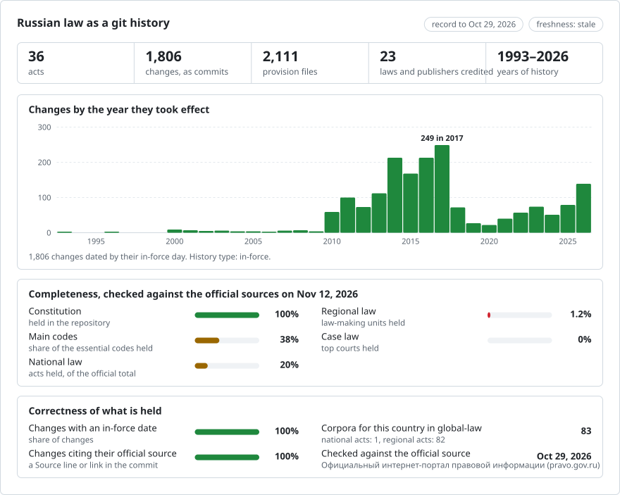

# Russia: law history in git

**English** · **[Или читайте на русском](README.md)**

<picture>
<source media="(prefers-color-scheme: dark)" srcset="data/effort-dark.svg">

</picture>

The law of Russia as a git history: one file per act (per article for the Constitution and the five acts of 1994-1999), one commit per version on the day it took effect, and the act that made each change as the commit's author (the publisher, for the oldest version available). `git blame` names the act behind every line; `git log` lists every change to an act; picking a date gives the text in force that day.

Part of [lexifina/global-law](https://github.com/lexifina/global-law), one git history for every country's law: this is Russia's national law, which global-law reads at `russia/national/acts/`.

**What is in it now:** the Constitution, in 21 versions from 12 December 1993 to 5 October 2022; and 1,790 federal acts signed 1994-2017, each in its current text only: 33 federal constitutional laws, 4 codes and 1,753 federal laws. [`laws.csv`](laws.csv) lists every federal act with its official number, state and source.

Each act is in `<kind>/<year>/<number>/` (`fkz/` federal constitutional laws, `fz/` federal laws and codes), one file `text.md` per act: `fz/2001/197/` is the Трудовой кодекс Российской Федерации, the Labour Code, Federal Law 197-FZ of 30 December 2001. The Constitution is `constitution/konstitutsiya/`, one file per article, as are the five acts of 1994-1999. Until 10 November 2026 the folders were named by act id (`fz/2001-197-fz/`); `git log --follow` follows the move, and `data/paths.json` maps each id to its folder.

The text is in Russian, as the portal publishes it; acts signed from 2000 keep the portal's notes ("(В редакции ...)") in the text. An English translation is not part of this record.

## Questions as git commands

| Question | Command |
| --- | --- |
| Every change to the Labour Code | `git log -p --word-diff --follow -- fz/2001/197/text.md` |
| Which act wrote each line of the Labour Code? | `git blame fz/2001/197/text.md` |
| Every version of the Labour Code, with the day each took effect | `git log --follow --diff-filter=AM --format="%h %(trailers:key=In-force,valueonly,separator=) %an" -- fz/2001/197/text.md` |
| The Labour Code in one of those versions | `git show <commit>:fz/2001-197-fz/text.md` |

**Outside git**, we also host this record publicly, for free:

- **[Ask Claude about Russian law](https://global-law.lexifina.com/v1/try_claude?country=russia)**: opens Claude with a first question ready.
- **[Ask ChatGPT](https://global-law.lexifina.com/v1/try_chatgpt?country=russia)**: the same question in ChatGPT.
- **[Call the API in your browser](https://global-law.lexifina.com/v1/search_law?query=%D0%B5%D0%B6%D0%B5%D0%B3%D0%BE%D0%B4%D0%BD%D1%8B%D0%B9+%D0%BE%D1%82%D0%BF%D1%83%D1%81%D0%BA&jurisdictions=russia)**: a search of Russian law for "ежегодный отпуск" (annual leave), returned as JSON. See the [documentation here](https://lexifina.com/api/global-law).

Both assistants read the record through the free Global law connector (MCP, `https://global-law.lexifina.com/mcp`); the first time, the chat gives you the link that adds it. Ask in Russian or in English.

**Host it yourself easily.** All it takes is git and Python, and the tools run on your machine:

```sh
git clone --depth 1 https://github.com/lexifina/global-law && cd global-law
python3 tools/countries.py add russia/national/acts
python3 tools/law.py show 2026-11-01 russia/national/acts/fz/2001/197/text.md
```

Opened in Claude Code, Cursor, VS Code or Codex, the clone also starts a local MCP server with the same tools ([MCP.md](https://github.com/lexifina/global-law/blob/main/MCP.md)).

## Dates

Each version carries the day it took effect in its `In-force:` trailer; the commit is dated at noon, Europe/Moscow, on that day:

- for the Constitution, the portal's date for each edition ("на DD.MM.YYYY"); editions that share a day (30 December 2008, 5 October 2022) are separate commits in the portal's order;
- for every other act, the day its current edition took effect, from the portal's edition date, the commencement clause of the act that made it and its official publication, or else the rule of Federal Law 5-FZ of 14 June 1994, art. 6 (ten days after official publication); the `In-force-basis:` trailer gives the evidence;
- committer dates keep the order in which acts were added, and the five acts of 1994-1999 carry 3 November 2026 as their commit date, so read the `In-force:` trailer, not `git log --before`.

Each edition of the Constitution is credited to the act the portal names for it: the 1993 referendum, the presidential decrees that changed names in Article 65's list of subjects, and federal constitutional laws and amendment laws. Every other act's one version is its "oldest version available", credited to the publisher, the Official Internet Portal of Legal Information (the five acts of 1994-1999 to Lexifina).

## How it is checked

- `tools/check_repo.py` reads every version back from git on the day it took effect and on the day before, and compares it with the corpus: 131 acts and 151 versions (the Constitution and the acts signed 2000-2009), no errors.
- `tools/check_words.py` compares the letters and digits of each text with the portal's own HTML: the 130 acts signed 2000-2009 match, none missing, extra or different. The Constitution's newest edition matches the portal's current text word for word.
- Two builds of the acts signed 2000-2009 from the same inputs gave the same commits. Results are in [`REPRODUCE.md`](REPRODUCE.md).
- History is append-only: published commits are not replaced and tags are not moved.

## What it does not show

- **Earlier versions of acts other than the Constitution.** Each is here in its current text only, so `git blame` names the publisher for every line, not the amending law.
- **Most federal law.** Only 4 codes are here (the Labour, Criminal Procedure, Civil Procedure and Administrative Court Procedure Codes): not the Civil, Criminal or Tax Codes. Acts signed after 2017 are not here, and 178 acts signed 2000-2009 are held back until their dates or tables can be verified (`REPRODUCE.md`).
- **Decrees, regulations, regional law, case law and treaties' texts.**
- **Images in acts signed 2010-2017**: their verbal text is here, the pictures are not.

## Sources

| Source | Kind | Past versions | Notes |
| --- | --- | --- | --- |
| [Официальный интернет-портал правовой информации](http://actual.pravo.gov.ru) (pravo.gov.ru), system "Законодательство России" | Official portal of legal information | yes, every edition with its date; built for the Constitution only | The text of every edition and the act that made it; the source of every act here |

## Licence

See [`LICENSE`](LICENSE). Official texts of laws are not objects of copyright in Russia (Civil Code, art. 1259(6)). Lexifina's own contributions (the arrangement of the history, the commit messages, the tables and the tools) are CC0 1.0.

No AI model wrote, translated or corrected legal text, and none runs when the history is built; the scripts were written by AI models (Claude Opus 5.5 for the Constitution, GPT-6 for the other acts; see [`REPRODUCE.md`](REPRODUCE.md)).

## More

From [lexifina/global-law](https://github.com/lexifina/global-law):

- [FEATURES.md](https://github.com/lexifina/global-law/blob/main/FEATURES.md): every feature, and what every corpus must support (`git blame`, `law.py`, the MCP tools)
- [FAQ.md](https://github.com/lexifina/global-law/blob/main/FAQ.md): questions and answers · [CONTRIBUTING.md](https://github.com/lexifina/global-law/blob/main/CONTRIBUTING.md): proposing changes · [MCP.md](https://github.com/lexifina/global-law/blob/main/MCP.md): the MCP server · [REPRODUCE.md](https://github.com/lexifina/global-law/blob/main/REPRODUCE.md): how it was built · [CHANGELOG.md](https://github.com/lexifina/global-law/blob/main/CHANGELOG.md)
- [FRESHNESS.md](https://github.com/lexifina/global-law/blob/main/FRESHNESS.md): how current each corpus is · [Monitoring](https://github.com/lexifina/global-law/tree/main/monitoring): whether updates are running · [WATCHING.md](https://github.com/lexifina/global-law/blob/main/WATCHING.md): how each official source is watched for changes
- [performance/](https://github.com/lexifina/global-law/tree/main/performance): how fast the tools are, measured
- [visualisations/](https://github.com/lexifina/global-law/tree/main/visualisations): charts and bridges across the world's law
- [Vulnerabilities](https://github.com/lexifina/global-law/tree/main/vulnerabilities): mistakes in legislation as published
