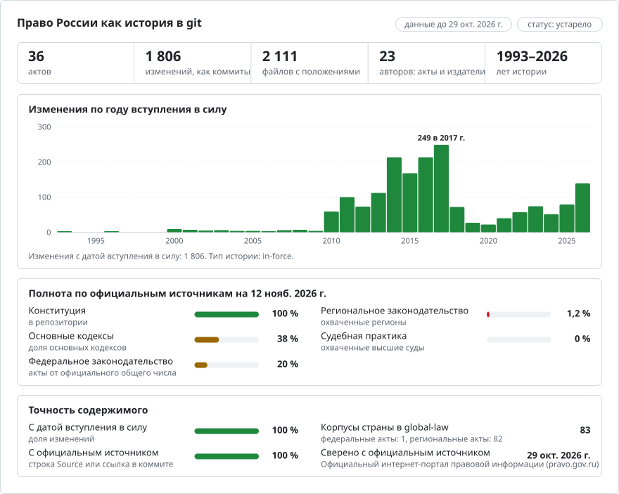

# Россия: история права в git

**Русский** · **[Or read it in English](README.en.md)**

<picture>
<source media="(prefers-color-scheme: dark)" srcset="data/ru/effort-dark.svg">

</picture>

Право России в виде истории git: один файл на каждый акт (для Конституции и пяти актов 1994–1999 годов — на каждую статью), один коммит на каждую редакцию в день её вступления в силу, а автором коммита указан акт, внёсший изменение (для старейшей доступной редакции — издатель). `git blame` называет акт, стоящий за каждой строкой; `git log` перечисляет все изменения акта; выбор даты даёт текст, действовавший в этот день.

Часть проекта [lexifina/global-law](https://github.com/lexifina/global-law), единой истории git для права всех стран: здесь национальное право России, которое global-law читает из `russia/national/acts/`.

**Что в нём сейчас:** Конституция в 21 редакции, с 12 декабря 1993 г. по 5 октября 2022 г.; и 1 790 федеральных актов, подписанных в 1994–2017 годах, каждый только в действующей редакции: 33 федеральных конституционных закона, 4 кодекса и 1 753 федеральных закона. [`laws.csv`](laws.csv) перечисляет все федеральные акты с официальным номером, состоянием и источником.

Каждый акт лежит в `<вид>/<год>/<номер>/` (`fkz/` — федеральные конституционные законы, `fz/` — федеральные законы и кодексы), по одному файлу `text.md` на акт: `fz/2001/197/` — Трудовой кодекс Российской Федерации, Федеральный закон от 30 декабря 2001 г. № 197-ФЗ. Конституция — `constitution/konstitutsiya/`, по одному файлу на статью, как и пять актов 1994–1999 годов. До 10 ноября 2026 г. папки назывались по идентификатору акта (`fz/2001-197-fz/`); `git log --follow` прослеживает перенос, а `data/paths.json` сопоставляет каждый идентификатор с папкой.

Тексты на русском языке, в том виде, в каком их публикует портал; в актах, подписанных с 2000 года, сохранены примечания портала («(В редакции ...)»). Перевода на английский в этом репозитории нет.

## Вопросы как команды git

| Вопрос | Команда |
| --- | --- |
| Все изменения Трудового кодекса | `git log -p --word-diff --follow -- fz/2001/197/text.md` |
| Какой акт написал каждую строку Трудового кодекса? | `git blame fz/2001/197/text.md` |
| Все редакции Трудового кодекса с днём вступления каждой в силу | `git log --follow --diff-filter=AM --format="%h %(trailers:key=In-force,valueonly,separator=) %an" -- fz/2001/197/text.md` |
| Трудовой кодекс в одной из этих редакций | `git show <commit>:fz/2001-197-fz/text.md` |

**Вне git** мы также открыто и бесплатно размещаем эти данные:

- **[Спросите Claude о праве России](https://global-law.lexifina.com/v1/try_claude?country=russia)**: открывает Claude с готовым первым вопросом.
- **[Спросите ChatGPT](https://global-law.lexifina.com/v1/try_chatgpt?country=russia)**: тот же вопрос в ChatGPT.
- **[Ищите в праве России на нашем сайте](https://lexifina.com/law?country=russia&q=%D0%B5%D0%B6%D0%B5%D0%B3%D0%BE%D0%B4%D0%BD%D1%8B%D0%B9+%D0%BE%D1%82%D0%BF%D1%83%D1%81%D0%BA)**: поиск «ежегодный отпуск», с текстом каждой нормы и её редакциями, без регистрации.
- **[REST API для разработчиков](https://global-law.lexifina.com/v1/search_law?query=%D0%B5%D0%B6%D0%B5%D0%B3%D0%BE%D0%B4%D0%BD%D1%8B%D0%B9+%D0%BE%D1%82%D0%BF%D1%83%D1%81%D0%BA&jurisdiction=russia)**: тот же поиск в формате JSON, без ключа. Документация [здесь](https://lexifina.com/api/global-law).

Оба ассистента читают данные через бесплатный коннектор Global law (MCP, `https://global-law.lexifina.com/mcp`); в первый раз чат даёт ссылку, по которой коннектор добавляется. Спрашивайте на русском или на английском.

**Легко запустить у себя.** Нужны только git и Python, а инструменты работают на вашем компьютере:

```sh
git clone --depth 1 https://github.com/lexifina/global-law && cd global-law
python3 tools/countries.py add russia/national/acts
python3 tools/law.py show 2026-11-01 russia/national/acts/fz/2001/197/text.md
```

Открытый в Claude Code, Cursor, VS Code или Codex, клон также запускает локальный MCP-сервер с теми же инструментами ([MCP.md](https://github.com/lexifina/global-law/blob/main/MCP.md)).

## Даты

Каждая редакция несёт день вступления в силу в трейлере `In-force:`; коммит датирован полднем по московскому времени (Europe/Moscow) этого дня:

- для Конституции — дата каждой редакции на портале («на ДД.ММ.ГГГГ»); редакции одного дня (30 декабря 2008 г., 5 октября 2022 г.) — отдельные коммиты в порядке, принятом на портале;
- для остальных актов — день вступления в силу действующей редакции: по дате редакции на портале, положению о вступлении в силу внёсшего её акта и его официальному опубликованию, а иначе по правилу статьи 6 Федерального закона от 14 июня 1994 г. № 5-ФЗ (по истечении десяти дней после официального опубликования); трейлер `In-force-basis:` указывает основание;
- даты коммиттера сохраняют порядок добавления актов, а пять актов 1994–1999 годов датированы 3 ноября 2026 г., поэтому читайте трейлер `In-force:`, а не `git log --before`.

Каждая редакция Конституции приписана акту, который называет для неё портал: всенародному голосованию 1993 года, указам Президента, изменявшим наименования в перечне субъектов статьи 65, федеральным конституционным законам и законам о поправках. Единственная редакция каждого из остальных актов — «старейшая доступная редакция», приписанная издателю, Официальному интернет-порталу правовой информации (пять актов 1994–1999 годов — Lexifina).

## Как это проверяется

- `tools/check_repo.py` считывает каждую редакцию из git в день её вступления в силу и накануне и сравнивает с корпусом: 131 акт и 151 редакция (Конституция и акты, подписанные в 2000–2009 годах), без ошибок.
- `tools/check_words.py` сравнивает буквы и цифры каждого текста с HTML самого портала: 130 актов, подписанных в 2000–2009 годах, совпадают, без пропущенных, лишних или отличающихся. Самая новая редакция Конституции дословно совпадает с текущим текстом на портале.
- Две сборки актов, подписанных в 2000–2009 годах, из одних и тех же данных дали одинаковые коммиты. Результаты — в [`REPRODUCE.md`](REPRODUCE.md).
- История только дополняется: опубликованные коммиты не заменяются, теги не переносятся.
- [vulnerabilities/](vulnerabilities/): возможные ошибки в законодательстве России, найденные детекторами global-law и проверенные вручную.

## Чего здесь нет

- **Прежних редакций актов, кроме Конституции.** Каждый акт представлен только в действующей редакции, поэтому `git blame` для каждой строки называет издателя, а не изменяющий закон.
- **Большей части федерального права.** Здесь только 4 кодекса (Трудовой, Уголовно-процессуальный, Гражданский процессуальный и Кодекс административного судопроизводства); Гражданского, Уголовного и Налогового кодексов нет. Актов, подписанных после 2017 года, нет, а 178 актов, подписанных в 2000–2009 годах, отложены, пока их даты или таблицы не будут проверены (`REPRODUCE.md`).
- **Указов, постановлений, регионального права, судебной практики и текстов международных договоров.**
- **Изображений в актах, подписанных в 2010–2017 годах**: их словесный текст здесь есть, картинок нет.

## Источники

| Источник | Вид | Прежние редакции | Примечания |
| --- | --- | --- | --- |
| [Официальный интернет-портал правовой информации](http://actual.pravo.gov.ru) (pravo.gov.ru), система «Законодательство России» | Официальный портал правовой информации | да, каждая редакция с датой; собраны только для Конституции | Текст каждой редакции и внёсший её акт; источник всех актов здесь |

## Лицензия

См. [`LICENSE`](LICENSE). Официальные тексты законов в России не являются объектами авторского права (ГК РФ, ст. 1259, п. 6). Собственный вклад Lexifina (устройство истории, сообщения коммитов, таблицы и инструменты) распространяется по CC0 1.0.

Ни одна модель ИИ не писала, не переводила и не исправляла текст права, и ни одна не работает при сборке истории; скрипты написаны моделями ИИ (Claude Opus 5.5 для Конституции, GPT-6 для остальных актов; см. [`REPRODUCE.md`](REPRODUCE.md)).

Это перевод английской версии ([README.en.md](README.en.md)); если они расходятся, действует английская версия.

## Визуализации

- [visualisations/](visualisations/): графики по данным этого репозитория. Ещё не построены.

## Ещё

Из репозитория [lexifina/global-law](https://github.com/lexifina/global-law) (на английском):

- [FEATURES.md](https://github.com/lexifina/global-law/blob/main/FEATURES.md): все функции и что должен поддерживать каждый корпус (`git blame`, `law.py`, инструменты MCP)
- [FAQ.md](https://github.com/lexifina/global-law/blob/main/FAQ.md): вопросы и ответы · [CONTRIBUTING.md](https://github.com/lexifina/global-law/blob/main/CONTRIBUTING.md): как предложить изменения · [MCP.md](https://github.com/lexifina/global-law/blob/main/MCP.md): MCP-сервер · [REPRODUCE.md](https://github.com/lexifina/global-law/blob/main/REPRODUCE.md): как он собран · [CHANGELOG.md](https://github.com/lexifina/global-law/blob/main/CHANGELOG.md)
- [FRESHNESS.md](https://github.com/lexifina/global-law/blob/main/FRESHNESS.md): насколько актуален каждый корпус · [Мониторинг](https://github.com/lexifina/global-law/tree/main/monitoring): работают ли обновления · [WATCHING.md](https://github.com/lexifina/global-law/blob/main/WATCHING.md): как каждый официальный источник отслеживается на изменения
- [performance/](https://github.com/lexifina/global-law/tree/main/performance): насколько быстры инструменты, по замерам
- [visualisations/](https://github.com/lexifina/global-law/tree/main/visualisations): графики и связи в праве всего мира
- [Уязвимости](https://github.com/lexifina/global-law/tree/main/vulnerabilities): ошибки в актах в опубликованном виде
