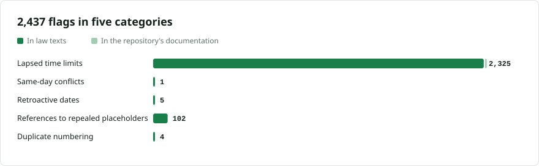

# Vulnerabilities in Russian law

[Русский](README.md) · **English**

<picture>
<source media="(prefers-color-scheme: dark)" srcset="img/flags-by-category-dark.svg">

</picture>

The vulnerability detectors from [lexifina/global-law](https://github.com/lexifina/global-law/tree/main/vulnerabilities) look for mechanical mistakes in legislation: a rule applying "until" a date that has passed, an act in force before it was published, two amendments to the same provision on the same day, a reference to an article that no longer exists. global-law's published list (9 November 2026) had no flags for Russia, although global-law already held this repository then (at an earlier commit). This is a run over this repository only, as it stood at commit [`273fdac`](https://github.com/lexifina/russia-law/commit/273fdacf198aac6ea93b663b6b94c9065c5fba7e) on 15 November 2026: the Constitution in 21 versions, from 12 December 1993 to 5 October 2022, and 1,790 federal acts signed 1994-2017 (33 federal constitutional laws, 4 codes and 1,753 federal laws), each as its current text.

**In short:** the detectors raised 2,437 flags. A language model reviewed 46 of the strongest, arguing each one for and against; 2 survived. Checked by hand in this repository, neither is a mistake in Russian law. The first is a spent step in a schedule of export duty on crude oil (42 percent for the months of 2016, 30 percent from 1 January 2017), which Federal Law No. 324-FZ of 28 November 2015 wrote into the Law of the Russian Federation "On the Customs Tariff". The second comes from how this repository dates the Constitution: its first version is dated 12 December 1993, the day of the nationwide vote, although by its own text the Constitution takes effect on official publication, which the commit itself gives as 25 December 1993. The model does not review references to repealed articles; read by hand, all 102 of them, three provisions in force turned out to cite articles that are gone. Article 28(3)(4) of Federal Law No. 206-FZ of 21 July 2014 "On Plant Quarantine" still refers to Article 8(3), although Federal Law No. 170-FZ of 11 June 2021 repealed Article 8 and, at the same time, reworded the opening words of the same Article 28(3); this looks like an oversight in the amendment (from 1 March 2027, point 4 is to read as Federal Law No. 214-FZ of 26 June 2026 words it). Article 30(2) of Federal Law No. 29-FZ of 2 January 2000 "On the Quality and Safety of Food Products" extends Article 10 to cosmetic products, but Federal Law No. 47-FZ of 1 March 2020 repealed Article 10. Article 117(4) of Federal Law No. 311-FZ of 27 November 2010 "On Customs Regulation in the Russian Federation", most of whose articles have been repealed, names three times the persons "referred to in Article 119(1) and Article 168(5)", both of which have been repealed. The other 97 flags are 94 references in articles on when an act takes effect and 3 misreadings. The hand check also found that `laws.csv` gives all 1,790 acts by their folders from before the move of 10 November 2026. Later, this will be formalised in Lean, similar to our work on [the US tax code](https://lexifina.com/blog/formalizing-the-us-tax-code) and [US case law](https://lexifina.com/blog/formalizing-all-us-case-law-in-lean).

A flag is a prompt to look, not legal advice, and nothing here has been tested in court.

## Flags by category

| Category | What it looks for | Flags | In law texts | Reviewed | Survived review |
| --- | --- | ---: | ---: | ---: | ---: |
| Lapsed time limits | Text still applying a rule "until" a date that has passed | 2,325 | 2,324 | 40 | 1 |
| Same-day conflicts | Two or more acts changing the same provision on the same day | 1 | 1 | 1 | 0 |
| Retroactive or pre-publication dates | An act in force before it was published | 5 | 5 | 5 | 1 |
| References to repealed placeholders | A provision citing an article that now reads only as repealed | 102 | 102 | 0 | 0 |
| Duplicate numbering | Two units with the same number in one act | 4 | 4 | 0 | 0 |

"In law texts" counts all the law this repository holds: the Constitution, the federal constitutional laws, the codes and the federal laws. The one other flag is in this repository's English README. Apart from the Constitution, every act here has one version, its current text, in one commit (1,655 acts signed 2010-2017 and 135 signed 1994-2009), so the search for repeal gaps, empty periods, stale amounts and references to deleted provisions found nothing to compare, and same-day conflicts and retroactive dates were found only in the Constitution's history. Nor did the search for dead currencies (amounts are in rubles), dead fines or publisher notes find anything. In Russian "до" means both "until" and "before", so many lapsed time limits are cut-off dates ("заключенных до 1 января 2017 года") or transitional deadlines, not limits on a rule. The search for lapsed time limits reads "до", "по" and "не позднее" (not later than) before a date with the month in words (230 flags come after "не позднее"); in the law texts it misses 2,331 phrases with a bare year ("до 2020 года"), 2,313 of them in the tables of the three federal budget laws for 2012-2014, where they are part of programme names ("на период до 2020 года"), and 5 with a month but no day ("не позднее декабря 2014").

*Edge cases: the 2 flags that survived the review, the 3 references to repealed articles found by reading, and what the other flags are, in [EDGE-CASES.en.md](EDGE-CASES.en.md).*

## Problems found in this repository

- **The Constitution dated by its adoption, not its entry into force:** the Constitution's first version is dated 12 December 1993, the day of the nationwide vote ([the commit](https://github.com/lexifina/russia-law/commit/8131263a6fce1d2e2632044ab593d4a8c0b923c7), `In-force: 1993-12-12`), although point 1 of Section Two ([`razdel-2.md`](https://github.com/lexifina/russia-law/blob/273fdacf198aac6ea93b663b6b94c9065c5fba7e/constitution/konstitutsiya/razdel-2.md)) says "Конституция Российской Федерации вступает в силу со дня официального ее опубликования по результатам всенародного голосования" and the same commit's `Published:` trailer gives 25 December 1993. The record therefore shows the Constitution in force 13 days before it was.
- **`laws.csv` gives the folders from before the move:** in all 1,790 rows the `path` column names the act's folder in its old form (`fz/2001-197-fz/`, and for the federal constitutional laws `fz/2000-1-fkz/`), which does not exist at commit `273fdac`: since 10 November 2026 the acts are in `fz/2001/197/` and `fkz/2000/1/`. `data/paths.json` maps one to the other.

## Files

| File | What it holds |
| --- | --- |
| [data/flags.csv](data/flags.csv) | Every flag, one row per article or act and issue |
| [data/reviewed.csv](data/reviewed.csv) | The 46 flags the model reviewed, with its verdict and reason |
| [data/by_category.csv](data/by_category.csv) | The counts in the table above |
| [tools/](tools/) | The scripts that made this run |

Columns: `category` and `category_ru` (the category in English and Russian), `detector`, `kind` (`law` or `other`), `path` (the file in this repository; for retroactive dates, the first file of the act), `date` (the date the flag turns on), `reference` (the act or line involved; for references to repealed placeholders, the article cited), `summary`, `score` (the detector's ranking, 0 to 1), `review` (`artefact`, `lawful` or `candidate_defect`), `survives_rebuttal`, `review_note` (the model's reason, in English), `url` (the file at the commit that was read, or, for retroactive dates, the commit).

## How it was made

- **Detectors:** global-law's [vulnerabilities/scripts](https://github.com/lexifina/global-law/tree/main/vulnerabilities/scripts), with the fixes in [tools/patch_detectors.py](tools/patch_detectors.py) and the other patches in [tools/](tools/README.md), run on this repository at commit `273fdac`. The history table the detectors read was built from this repository's own commits (the author, the act that made each change, and the `In-force` and `Kind` trailers), counting as law the 21 commits of the Constitution's history (kinds `law`, `decree` and `referendum`); the current texts of the other acts (kinds `baseline` and `first-text`) are read as the acts' text, not as changes. Paths from before the folder move of 10 November 2026 are mapped to each act's folder today through `data/paths.json`. Fixes made for this repository ([tools/](tools/README.md)): the search for references to repealed articles now reads an act kept as one file (`text.md`) article by article, where, of the 1,790 acts, it had seen only the five of 1994-1999 kept one file per article; an article that declares other acts repealed ("О признании утратившими силу ...") is no longer itself taken for a repealed article; inserted articles ("статья 121", "статья 12.1", "статья 9¹") are no longer read as article 12 or 9; an act named after a list of articles ("статью 21, пункт 1 статьи 25 и статью 29 Федерального закона от 8 мая 2010 года ...") is no longer taken for the citing act itself; an amending law's article ("Внести в Федеральный закон ... следующие изменения: ...") is no longer read as citing the amending law's own articles; and "§ 41" is no longer taken for a second "§ 4".
- **Model review:** gpt-5.4-mini, the 40 strongest flags per category, and for lapsed time limits also the 40 strongest in law texts (here the same 40); one pass says whether a flag is real, a second argues that it is not. Where a flag was reviewed twice, the later review is kept. There were no empty periods to review, and the model does not review references to repealed placeholders or duplicate numbering. global-law's own list used a different model.
- **Hand check:** every case that survived, and every one of the 102 references to repealed articles, was read in this repository's texts and commits. This repository does not hold the texts of Federal Laws No. 170-FZ of 2021, No. 214-FZ of 2026, No. 47-FZ of 2020, No. 20-FZ of 2021 and No. 289-FZ of 2018, nor of the presidential decrees that changed Article 65 of the Constitution; those need an official source. The other flags were read by category.

To report a correction, open an issue with the provision and an official source.

## Licence

The lists and notes are Lexifina's, dedicated to the public domain under CC0 1.0, like the rest of this repository's own contributions. Quoted law text is as the Official Internet Portal of Legal Information (pravo.gov.ru) publishes it; official texts of laws are not objects of copyright in Russia (Civil Code of the Russian Federation, Article 1259(6)). See [LICENSE](../LICENSE).
