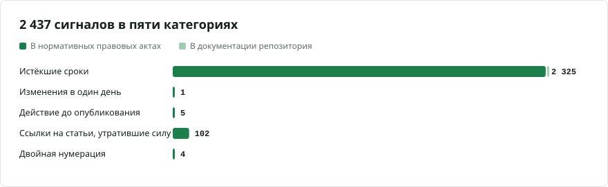

# Уязвимости в законодательстве России

**Русский** · [English](README.en.md)

<picture>
<source media="(prefers-color-scheme: dark)" srcset="img/flags-by-category-dark.ru.svg">

</picture>

Детекторы уязвимостей из репозитория [lexifina/global-law](https://github.com/lexifina/global-law/tree/main/vulnerabilities) ищут механические ошибки в законодательстве: норму, которая всё ещё действует «до» уже прошедшей даты, акт, вступивший в силу до его опубликования, два изменения одной нормы в один день, ссылку на статью, которой больше нет. Перечень, опубликованный global-law 9 ноября 2026 года, не содержал ни одного сигнала по России, хотя global-law уже тогда включал этот репозиторий (по более раннему коммиту). Здесь проверен только этот репозиторий в состоянии на коммит [`273fdac`](https://github.com/lexifina/russia-law/commit/273fdacf198aac6ea93b663b6b94c9065c5fba7e) от 15 ноября 2026 года: Конституция в 21 редакции, с 12 декабря 1993 года по 5 октября 2022 года, и 1 790 федеральных актов, подписанных в 1994–2017 годах (33 федеральных конституционных закона, 4 кодекса и 1 753 федеральных закона), каждый в текущей редакции.

**Коротко:** детекторы выдали 2 437 сигналов. Языковая модель рассмотрела 46 самых сильных, приводя по каждому доводы за и против; 2 из них устояли. После ручной проверки ни один из них не оказался ошибкой в законодательстве России. Первый — исчерпавшая себя ступень шкалы вывозной таможенной пошлины на сырую нефть (42 процента для месяцев 2016 года, 30 процентов с 1 января 2017 года), которую Федеральный закон от 28 ноября 2015 года № 324-ФЗ установил в Законе Российской Федерации «О таможенном тарифе». Второй объясняется тем, как этот репозиторий датирует Конституцию: её первая редакция датирована днём всенародного голосования, 12 декабря 1993 года, хотя по её собственному тексту Конституция вступает в силу со дня официального опубликования, а опубликована она, как указывает сам коммит, 25 декабря 1993 года. Ссылки на статьи, утратившие силу, модель не рассматривает; при ручном чтении всех 102 таких сигналов три действующие нормы оказались ссылками на статьи, которых больше нет. Пункт 4 части 3 статьи 28 Федерального закона от 21 июля 2014 года № 206-ФЗ «О карантине растений» по-прежнему отсылает к части 3 статьи 8, хотя статью 8 признал утратившей силу Федеральный закон от 11 июня 2021 года № 170-ФЗ, который тогда же изложил в новой редакции вводные слова той же части 3; это похоже на упущение при внесении изменений (с 1 марта 2027 года пункт 4 будет действовать в редакции Федерального закона от 26 июня 2026 года № 214-ФЗ). Часть 2 статьи 30 Федерального закона от 2 января 2000 года № 29-ФЗ «О качестве и безопасности пищевых продуктов» распространяет на косметическую продукцию положения статьи 10, утратившей силу по Федеральному закону от 1 марта 2020 года № 47-ФЗ. Часть 4 статьи 117 Федерального закона от 27 ноября 2010 года № 311-ФЗ «О таможенном регулировании в Российской Федерации», большая часть статей которого утратила силу, трижды называет лиц, «указанных в части 1 статьи 119, части 5 статьи 168», хотя обе эти статьи утратили силу. Остальные 97 сигналов — 94 отсылки в статьях о вступлении актов в силу и 3 ошибки чтения. Кроме того, проверка показала, что в `laws.csv` все 1 790 актов указаны с папками, существовавшими до переноса 10 ноября 2026 года. В дальнейшем это будет формализовано в Lean, по образцу нашей работы над [налоговым кодексом США](https://lexifina.com/blog/formalizing-the-us-tax-code) и [судебной практикой США](https://lexifina.com/blog/formalizing-all-us-case-law-in-lean).

Сигнал — это повод присмотреться, а не юридическая консультация; ничто из изложенного здесь не проверялось в суде.

## Сигналы по категориям

| Категория | Что ищет | Сигналы | В нормативных правовых актах | Рассмотрены | Устояли после рассмотрения |
| --- | --- | ---: | ---: | ---: | ---: |
| Истёкшие сроки | Текст, по-прежнему применяющий норму «до» даты, которая уже прошла | 2 325 | 2 324 | 40 | 1 |
| Изменения в один день | Два или более акта, изменяющие одну норму в один и тот же день | 1 | 1 | 1 | 0 |
| Вступление в силу до опубликования | Акт, вступивший в силу до того, как он был опубликован | 5 | 5 | 5 | 1 |
| Ссылки на статьи, утратившие силу | Норма, ссылающаяся на статью, от которой осталась лишь отметка об утрате силы | 102 | 102 | 0 | 0 |
| Двойная нумерация | Две структурные единицы с одним номером в одном акте | 4 | 4 | 0 | 0 |

«В нормативных правовых актах» учитывает всё законодательство, которое содержит этот репозиторий: Конституцию, федеральные конституционные законы, кодексы и федеральные законы. Единственный остальной сигнал находится в английском README репозитория. Кроме Конституции, каждый акт представлен здесь одной редакцией, текущей, в одном коммите (1 655 актов, подписанных в 2010–2017 годах, и 135 — в 1994–2009 годах), поэтому поиск пробелов после отмены, пустых периодов, устаревших сумм и ссылок на исключённые нормы ничего не нашёл: сравнивать нечего, а изменения в один день и вступление в силу до опубликования найдены только в истории Конституции. Ничего не нашёл и поиск вышедших из обращения валют (суммы указаны в рублях), санкций без состава и примечаний публикатора. Предлог «до» означает и «вплоть до», и «ранее», поэтому многие истёкшие сроки — это лишь граничные даты («заключенных до 1 января 2017 года») или переходные сроки, а не сроки действия. Поиск истёкших сроков читает «до», «по» и «не позднее» перед датой с месяцем, написанным словом (230 сигналов — после «не позднее»); в нормативных правовых актах он пропускает 2 331 выражение с одним лишь годом («до 2020 года»), из них 2 313 — в таблицах трёх законов о федеральном бюджете на 2012–2014 годы, где это часть названий программ («на период до 2020 года»), и 5 выражений с месяцем без числа («не позднее декабря 2014»).

*Пограничные случаи: 2 сигнала, устоявших после рассмотрения, 3 ссылки на статьи, утратившие силу, найденные при ручном чтении, и что представляют собой остальные сигналы, — в [EDGE-CASES.md](EDGE-CASES.md).*

## Проблемы, обнаруженные в этом репозитории

- **Конституция датирована днём принятия, а не вступления в силу:** первая редакция Конституции датирована 12 декабря 1993 года, днём всенародного голосования ([коммит](https://github.com/lexifina/russia-law/commit/8131263a6fce1d2e2632044ab593d4a8c0b923c7), `In-force: 1993-12-12`), хотя пункт 1 раздела второго ([`razdel-2.md`](https://github.com/lexifina/russia-law/blob/273fdacf198aac6ea93b663b6b94c9065c5fba7e/constitution/konstitutsiya/razdel-2.md)) гласит: «Конституция Российской Федерации вступает в силу со дня официального ее опубликования по результатам всенародного голосования», а трейлер того же коммита `Published:` указывает 25 декабря 1993 года. Поэтому запись показывает Конституцию действующей на 13 дней раньше, чем она вступила в силу.
- **`laws.csv` указывает папки до переноса:** во всех 1 790 строках столбец `path` называет папку акта в прежнем виде (`fz/2001-197-fz/`, а федеральные конституционные законы — `fz/2000-1-fkz/`), которой в коммите `273fdac` нет: с 10 ноября 2026 года акты лежат в `fz/2001/197/` и `fkz/2000/1/`. Соответствие даёт `data/paths.json`.

## Файлы

| Файл | Что содержит |
| --- | --- |
| [data/flags.csv](data/flags.csv) | Все сигналы, по одной строке на статью или акт и проблему |
| [data/reviewed.csv](data/reviewed.csv) | 46 сигналов, рассмотренных моделью, с её оценкой и обоснованием |
| [data/by_category.csv](data/by_category.csv) | Числа из таблицы выше |
| [tools/](tools/) | Скрипты, с помощью которых выполнена проверка |

Столбцы: `category` и `category_ru` (категория на английском и на русском), `detector`, `kind` (`law` или `other`), `path` (файл в этом репозитории; для вступления в силу до опубликования — первый файл акта), `date` (дата, к которой относится сигнал), `reference` (затронутый акт или строка; для ссылок на статьи, утратившие силу, — номер статьи), `summary`, `score` (оценка детектора, от 0 до 1), `review` (`artefact`, `lawful` или `candidate_defect`), `survives_rebuttal`, `review_note` (обоснование модели, на английском), `url` (файл в прочитанном коммите, а для вступления в силу до опубликования — коммит).

## Как это сделано

- **Детекторы:** [vulnerabilities/scripts](https://github.com/lexifina/global-law/tree/main/vulnerabilities/scripts) из global-law с исправлениями из [tools/patch_detectors.py](tools/patch_detectors.py) и другими исправлениями из [tools/](tools/README.md), запущенные на этом репозитории по коммиту `273fdac`. Таблица истории, которую читают детекторы, построена по собственным коммитам репозитория (автор, то есть акт, внёсший каждое изменение, и трейлеры `In-force` и `Kind`); законодательством считается 21 коммит истории Конституции (виды `law`, `decree` и `referendum`), а текущие редакции остальных актов (виды `baseline` и `first-text`) читаются как текст актов, но не как изменения. Пути до переноса папок 10 ноября 2026 года сопоставлены с нынешними папками актов через `data/paths.json`. Исправления, сделанные для этого репозитория ([tools/](tools/README.md)): поиск ссылок на статьи, утратившие силу, теперь читает акты, хранящиеся одним файлом (`text.md`), по статьям — до этого из 1 790 актов он видел только пять актов 1994–1999 годов, хранящихся по статьям; статья, признающая утратившими силу другие акты («О признании утратившими силу ...»), больше не принимается за статью, утратившую силу; статьи, вставленные между другими («статья 121», «статья 12.1», «статья 9¹»), больше не принимаются за статью 12 или 9; акт, названный после перечня статей («статью 21, пункт 1 статьи 25 и статью 29 Федерального закона от 8 мая 2010 года ...»), больше не принимается за сам акт; статья изменяющего закона («Внести в Федеральный закон ... следующие изменения: ...») больше не читается как ссылка на статьи самого изменяющего закона; «§ 41» больше не принимается за второй «§ 4».
- **Рассмотрение моделью:** gpt-5.4-mini, 40 самых сильных сигналов в каждой категории, а для истёкших сроков ещё и 40 самых сильных в нормативных правовых актах (здесь те же 40); первый проход оценивает, реален ли сигнал, второй доказывает, что нет. Если сигнал рассмотрен дважды, действует более позднее рассмотрение. Пустых периодов для рассмотрения не было, а ссылки на статьи, утратившие силу, и двойную нумерацию модель не рассматривает. Собственный перечень global-law составлен другой моделью.
- **Ручная проверка:** каждый устоявший случай и каждая из 102 ссылок на статьи, утратившие силу, прочитаны в текстах и коммитах этого репозитория. Тексты Федеральных законов № 170-ФЗ 2021 года, № 214-ФЗ 2026 года, № 47-ФЗ 2020 года, № 20-ФЗ 2021 года и № 289-ФЗ 2018 года, а также указов Президента, изменявших статью 65 Конституции, в этом репозитории нет; их нужно проверять по официальному источнику. Остальные сигналы прочитаны по категориям.

Чтобы сообщить об исправлении, откройте issue с указанием нормы и официального источника.

## Лицензия

Перечни и примечания принадлежат Lexifina и переданы в общественное достояние на условиях CC0 1.0, как и остальной собственный вклад в этот репозиторий. Цитируемый текст законодательства приводится в том виде, в каком его публикует Официальный интернет-портал правовой информации (pravo.gov.ru); официальные тексты законов не являются в России объектами авторского права (Гражданский кодекс Российской Федерации, статья 1259, пункт 6). См. [LICENSE](../LICENSE).
